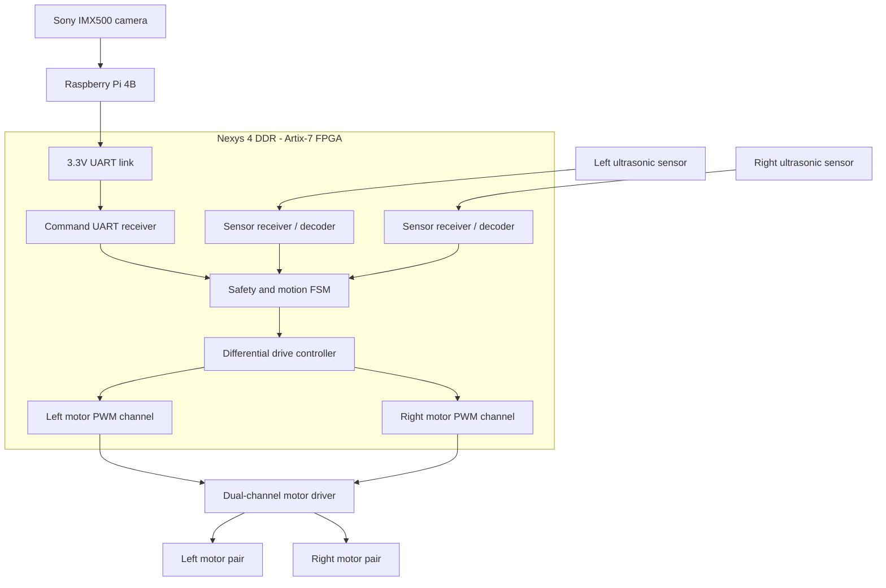

# Architecture

## Responsibilities

- **Raspberry Pi 4B:** camera input, Sony IMX500 inference, and high-level motion requests.
- **Artix-7 FPGA:** low-latency sensor acquisition, decision logic, command watchdog, and hardware motor outputs.
- **Motor driver:** supplies motor current; the FPGA must never power the motors directly.

The FPGA should have final authority over movement: an unsafe distance, stale Pi command, or disabled state must override a motion request. **That interlock is planned, not present in the Stage 1 demonstration.**

## Planned system diagram

*The sensor inputs, link, state machine, and motor-driver connections are a target design, not wired or implemented yet.*

## Data and control flow

1. The AI camera and Pi interpret the scene and generate a desired motion command.
2. A UART receiver on the FPGA decodes incoming commands and updates their freshness status.
3. Sensor interfaces supply obstacle distance measurements in parallel.
4. A safety FSM selects safe motion, including a stop on loss of communication.
5. A differential drive block converts motion into left/right motor targets.
6. Two PWM channels command the external motor driver.

## Implementation choices

**Why split Pi and FPGA?** Camera inference is a natural fit for the Pi/IMX500; pulse generation, sensor timing, and emergency motor gating are deterministic in RTL.

**Why two motor PWM channels?** Skid-steer turning works by changing the left and right motor speeds. Each channel ultimately needs two mutually exclusive direction PWM outputs for the proposed MDD3A-style motor driver.

**Why start without the motors?** The onboard switches and LEDs expose basic PWM behavior without risks from motor wiring, supply current, and unexpected movement.

## What is actually implemented in Stage 1

The Stage 1 PWM block uses the 100 MHz board clock and defaults to 10 kHz PWM. Inputs are sampled at PWM period boundaries; enable/reset gate the outputs without waiting for the period boundary. The current module is suitable for FPGA/LED demonstrations; **do not connect motors before adding safe reversal and fault handling.**
